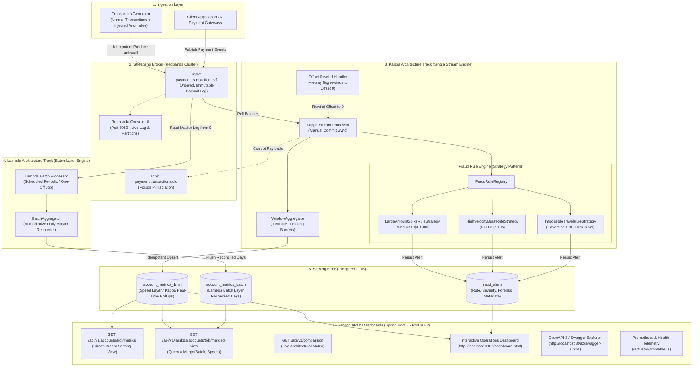
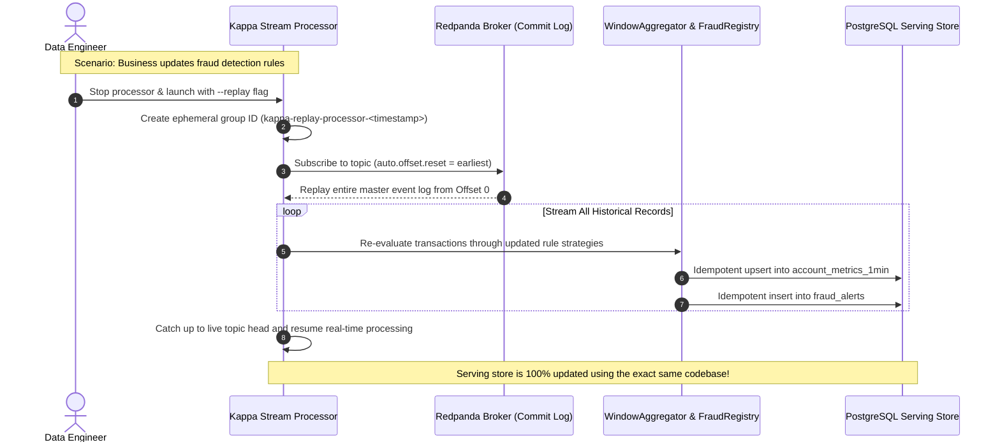
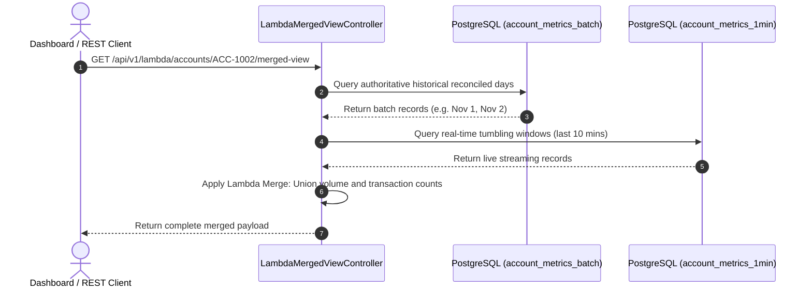

# Real-Time Data Architectures: Kappa vs. Lambda in Enterprise Production

[](https://openjdk.org/projects/jdk/21/)
[](https://spring.io/projects/spring-boot)
[](https://redpanda.com/)
[](https://www.postgresql.org/)
[](LICENSE)

An enterprise production-grade implementation and side-by-side benchmark of **Kappa Architecture** ($\kappa$) and **Lambda Architecture** ($\Lambda$), inspired by Natesh Somanna's foundational analysis on distributed big data processing systems:
👉 **[Read the Reference Article on Medium: Kappa vs. Lambda Architecture in Large-scale Data Processing Systems](https://medium.com/@natesh.somanna/kappa-vs-lambda-architecture-in-large-scale-data-processing-systems-1da30973591d)**

---

## 1. Conceptual Foundation: What the Article is Talking About

In modern enterprise data platforms, organizations face a fundamental engineering challenge:  
> *"How do we process massive historical datasets with 100% precision and fault tolerance while simultaneously analyzing incoming live events with sub-second latency?"*

Historically, relational databases and standard OLAP warehouses could not handle this dual constraint at scale. Two primary distributed system paradigms emerged:

---

### Lambda Architecture ($\Lambda$)
* **Origin:** Proposed by **Nathan Marz** (creator of Apache Storm and author of *Big Data*) in 2011.
* **Core Philosophy:** **"Batch for accuracy, streaming for low latency."**
* **Structure:** The system is split into three distinct layers:
  1. **Batch Layer:** Periodically recomputes the entire master dataset (historically via Hadoop MapReduce, Apache Spark, or Hive) to generate authoritative, immutable batch views. Highly accurate, but high latency (hours to days).
  2. **Speed Layer:** Processes incoming data in real time (via Apache Storm, Flink, or streaming engines) to fill the gap for recent events not yet processed by the batch layer. Low latency (milliseconds), but may tolerate eventual consistency or rough approximations.
  3. **Serving Layer:** Indexes both the batch views and the real-time speed views to answer queries via the classic Lambda formula:
     $$\text{Query} = \text{Merge}(\text{Batch View}, \text{Real-time Speed View})$$
* **The Fatal Flaw of Lambda:** **Dual-Codebase Synchronization Overhead.**  
  Engineers must write and maintain their business logic **twice**—once in the batch codebase (e.g., Spark SQL / MapReduce) and once in the streaming codebase (e.g., Storm / Flink). Keeping algorithms, edge cases, and bug fixes synchronized across two disparate systems is notoriously difficult and error-prone.

---

### Kappa Architecture ($\kappa$)
* **Origin:** Proposed by **Jay Kreps** (creator of Apache Kafka and CEO of Confluent) in 2014 as an evolution and simplification.
* **Core Philosophy:** **"Everything is an infinite event stream."**
* **Structure:** Eliminates the batch layer entirely.
  1. **Immutable Log:** All data flows into an ordered, append-only distributed commit log (Apache Kafka, Redpanda) that acts as the single source of truth.
  2. **Unified Stream Processor:** A single stateful stream processing engine (Apache Flink, Kafka Streams, or Reactive Java) handles all data processing using **one unified codebase**.
  3. **Historical Reprocessing via Offset Rewind:** If business rules change or bugs are fixed, you do **not** run a separate batch pipeline. Instead, you spin up a new instance of your stream processor, rewind its consumer group offset to `0` (the beginning of the topic), and re-stream the historical log through the updated logic into a new serving view.

---

### Side-by-Side Architectural Comparison

| Dimension | **Lambda Architecture ($\Lambda$)** | **Kappa Architecture ($\kappa$)** |
| :--- | :--- | :--- |
| **Philosophical Premise** | "Batch for accuracy, streaming for speed" | "Everything is an infinite event stream" |
| **Pipeline Count** | **2 Parallel Pipelines** (Batch + Speed) | **1 Single Unified Pipeline** (Stream Only) |
| **Codebases** | Dual (must maintain batch and stream logic) | Single (one unified streaming codebase) |
| **Serving Query** | $\text{Merge}(\text{Batch View}, \text{Speed View})$ | Direct query against stream-updated views |
| **Historical Reprocessing** | Execute batch jobs over archived Parquet/S3 files | Rewind consumer offset to `0` (`--replay`) |
| **Synchronization Risk** | High (divergence between batch & stream logic) | Zero (single source of business logic) |
| **Operational Stack** | Heavy (Kafka + Spark/Hadoop + Flink + DB) | Streamlined (Redpanda + Stream Engine + DB) |

---

## 2. System Architecture & End-to-End Data Flow

This repository implements **both architectures side-by-side** over the same real-time financial transaction event stream so you can directly inspect, compare, and verify their operational behaviors.



---

## 3. Design Patterns & Clean Architecture Class Structure


---

## 4. Sequence Diagrams: Replay vs. Batch Merge

### 4.1. The Kappa Replay Sequence (`--replay`)
Demonstrating how historical data is reprocessed in Kappa without any batch infrastructure:



### 4.2. The Lambda Batch Merge Sequence (`Query = Merge(Batch, Speed)`)
Demonstrating how queries are answered in Lambda architecture:



---

## 5. Modules in this Project

```text
streaming-platform/
├── docker/
│   ├── docker-compose.yml          # Redpanda, Console, PostgreSQL, Prometheus, Grafana
│   ├── init-db.sql                 # Serving schemas for both Kappa & Lambda
│   └── prometheus/prometheus.yml   # Prometheus scraper configuration
├── event-contracts/                # Domain models with Jakarta Bean Validation
├── transaction-generator/          # High-velocity producer with injected fraud anomalies
├── stream-processor/               # KAPPA TRACK: Stateful stream engine + Strategy Pattern
├── lambda-batch-processor/         # LAMBDA TRACK: Batch layer master reconciler
├── serving-api/                    # Spring Boot 3 Serving REST API & Operations Dashboard
└── scripts/
    └── run-infrastructure.sh       # One-click startup for container infrastructure
```

---

## 6. Quick Start & Execution Guide

### Prerequisites
* Java 21+ installed
* Docker & Docker Compose (or Colima) installed
* Maven 3.9+ (or use IntelliJ's bundled Maven)

---

### Step 1: Start Container Infrastructure
```bash
./streaming-platform/scripts/run-infrastructure.sh
```
* **Redpanda Broker:** `localhost:9092`
* **Redpanda Console:** [http://localhost:8080](http://localhost:8080)
* **PostgreSQL Serving DB:** `localhost:5432` (`streaming_db` / user: `postgres` / pass: `postgrespassword`)
* **Prometheus:** `http://localhost:9090`
* **Grafana:** `http://localhost:3000` *(admin / admin)*

---

### Step 2: Build the Complete Platform
```bash
cd streaming-platform
mvn clean package -DskipTests
```

---

### Step 3: Run the Services

#### Terminal 1: Launch the Kappa Stream Processor
```bash
java -jar stream-processor/target/stream-processor-1.0.0-SNAPSHOT.jar
```

#### Terminal 2: Run the Transaction Generator
```bash
java -jar transaction-generator/target/transaction-generator-1.0.0-SNAPSHOT.jar
```

#### Terminal 3: Run the Lambda Batch Processor (Batch Layer)
To run a one-off batch reconciliation cycle:
```bash
java -jar lambda-batch-processor/target/lambda-batch-processor-1.0.0-SNAPSHOT.jar --run-once
```
*(Or run without `--run-once` to keep it running as a periodic daemon).*

#### Terminal 4: Launch the Spring Boot 3 Serving API & Dashboard
```bash
java -jar serving-api/target/serving-api-1.0.0-SNAPSHOT.jar
```

---

## 7. Interactive Dashboards & API Endpoints

### 7.1. Operations & Fraud Web Dashboard
Open your browser to:  
👉 **[http://localhost:8082](http://localhost:8082)** *(or [http://localhost:8082/dashboard.html](http://localhost:8082/dashboard.html))*

Features:
* **Tab 1: Kappa Streaming View:** Live real-time tumbling window metrics and fraud triage feed with 1-click incident resolution.
* **Tab 2: Lambda Dual-Layer Merged View:** Live side-by-side view showing the Batch Layer table (`account_metrics_batch`) and Speed Layer table (`account_metrics_1min`) merged into a single consolidated result.
* **Tab 3: Architectural Decision Matrix:** Interactive comparison of Lambda vs. Kappa trade-offs.

### 7.2. OpenAPI 3 / Swagger Explorer
👉 **[http://localhost:8082/swagger-ui.html](http://localhost:8082/swagger-ui.html)**

### 7.3. Key API Endpoints
* **Platform KPI Summary:**
  ```bash
  curl http://localhost:8082/api/v1/stats
  ```
* **Kappa Stream Metrics (1-Min Windows):**
  ```bash
  curl http://localhost:8082/api/v1/accounts/ACC-1002/metrics
  ```
* **Lambda Merged View ($\text{Query} = \text{Merge}(\text{Batch}, \text{Speed})$):**
  ```bash
  curl http://localhost:8082/api/v1/lambda/accounts/ACC-1002/merged-view
  ```
* **Architecture Comparison Matrix:**
  ```bash
  curl http://localhost:8082/api/v1/comparison
  ```
* **Query Critical Fraud Alerts:**
  ```bash
  curl "http://localhost:8082/api/v1/fraud/alerts?severity=CRITICAL"
  ```
* **Resolve a Fraud Incident (Validation Protected):**
  ```bash
  curl -X POST http://localhost:8082/api/v1/fraud/alerts/<ALERT_ID>/resolve \
       -H "Content-Type: application/json" \
       -d '{"note": "Cardholder verified overseas travel transaction.", "resolvedBy": "fraud_officer_42"}'
  ```

---

## 8. Automated Testing & Verification Suite

To run all automated unit and integration tests across the 5 modules:
```bash
cd streaming-platform
mvn test
```

### Verified Test Suites:
* **`FraudRuleStrategyTest`:** Unit tests verifying individual Strategy pattern implementations (`LargeAmountSpike`, `HighVelocityBurst`, `ImpossibleTravel`).
* **`WindowAggregatorTest`:** Verifies tumbling window state calculation and metrics rollups.
* **`GeoUtilsTest` & `DateTimeUtilsTest`:** Verifies geodesic Haversine distance and epoch window math.
* **`PaymentTransactionValidationTest`:** Verifies Jakarta Bean Validation constraints and defensive record boundaries.
* **`FraudAlertServiceTest`:** Mockito service test verifying business rule invariants during alert resolution.
* **`BatchAggregatorTest`:** Verifies Lambda batch reconciliation across date boundaries.
