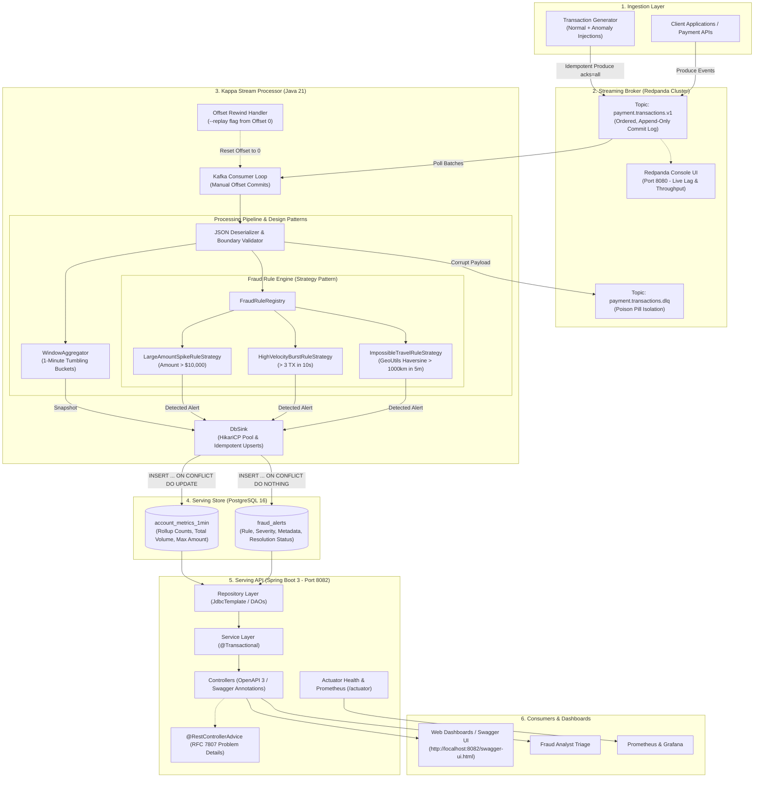
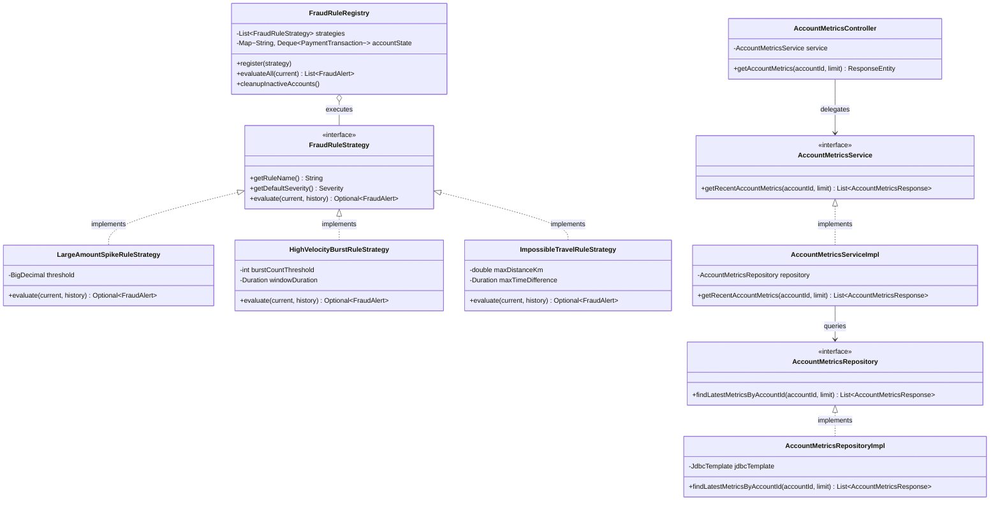
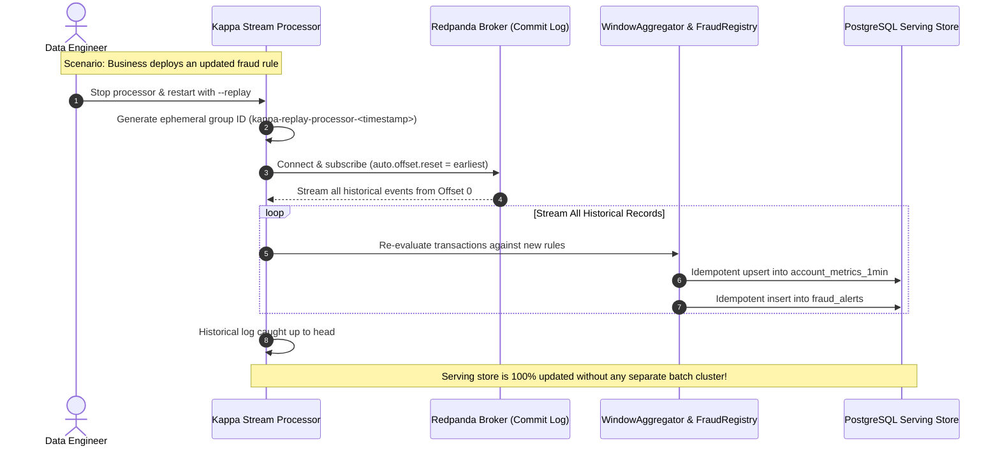

# Enterprise Production-Grade Streaming & Fraud Platform (Kappa Architecture)

An enterprise production-grade implementation of **Kappa Architecture** featuring **Redpanda**, stateful stream processing with design patterns (Strategy, Registry, Repository), and a **Spring Boot 3** REST API with **OpenAPI 3 / Swagger**, **RFC 7807 Problem Details**, and **Micrometer/Prometheus** telemetry.

---

## 1. End-to-End System & Data Flow Architecture



---

## 2. Strategy Pattern & Clean Architecture Class Hierarchy



---

## 3. Kappa Historical Reprocessing Sequence Diagram (`--replay`)



---

## 4. Enterprise Standards & Design Patterns Implemented

| Category | Implementation Details |
| :--- | :--- |
| **Strategy Pattern** | Pluggable `FraudRuleStrategy` interface with modular rules (`LargeAmountSpikeRuleStrategy`, `HighVelocityBurstRuleStrategy`, `ImpossibleTravelRuleStrategy`). |
| **Clean Architecture** | Strict separation: Controller ➔ Service (Interface + Impl) ➔ Repository (Interface + Impl) ➔ DTOs / Entities. |
| **Exception Handling** | Centralized `@RestControllerAdvice` mapping exceptions to standard **RFC 7807 / RFC 9457 Problem Details** with field-level validation errors. |
| **API Documentation** | Automated **OpenAPI 3 (Swagger UI)** documentation available at `/swagger-ui.html`. |
| **Validation** | Jakarta Bean Validation (`@NotNull`, `@NotBlank`, `@Size`, `@DecimalMin`, `@Valid`). |
| **Observability** | Custom Spring Actuator `HealthIndicator` (`/actuator/health`) and Prometheus scraping metrics (`/actuator/prometheus`). |
| **Stream Resilience** | Manual offset commits, tuned HikariCP connection pool, and automated routing of poison pills to a **Dead Letter Queue (DLQ)**. |
| **Log Traceability** | Structured logging with SLF4J MDC attaching `accountId` and `txId` correlation tags. |

---

## 5. Quick Start

### Step 1: Start Infrastructure (Redpanda + Postgres + Console)
```bash
./streaming-platform/scripts/run-infrastructure.sh
```

* **Redpanda Broker:** `localhost:9092`
* **Redpanda Console UI:** [http://localhost:8080](http://localhost:8080)
* **PostgreSQL DB:** `localhost:5432` (`streaming_db` / user: `postgres` / pass: `postgrespassword`)

---

### Step 2: Build the Applications
Using Maven (Java 21):
```bash
cd streaming-platform
mvn clean package -DskipTests
```

---

### Step 3: Run the Services (3 Terminal Windows)

#### Terminal 1: Run the Kappa Stream Processor
```bash
java -jar stream-processor/target/stream-processor-1.0.0-SNAPSHOT.jar
```
*Listens to `payment.transactions.v1`, runs stateful window aggregations, evaluates fraud strategy rules, and flushes to PostgreSQL.*

#### Terminal 2: Run the Transaction Generator
```bash
java -jar transaction-generator/target/transaction-generator-1.0.0-SNAPSHOT.jar
```
*Emits transactions with idempotent delivery and periodically injects anomalies.*

#### Terminal 3: Run the Spring Boot 3 Serving API
```bash
java -jar serving-api/target/serving-api-1.0.0-SNAPSHOT.jar
```
*Launches the REST API on port `8082`.*

---

## 6. API Documentation & Endpoints

### Swagger UI (Interactive API Explorer)
Open [http://localhost:8082/swagger-ui.html](http://localhost:8082/swagger-ui.html) to view all endpoints, request/response models, and test them live.

### High-Level Summary
```bash
curl http://localhost:8082/api/v1/stats
```

### Account Metrics (1-Minute Tumbling Windows)
```bash
curl http://localhost:8082/api/v1/accounts/ACC-1002/metrics
```

### Query Fraud Alerts
```bash
curl "http://localhost:8082/api/v1/fraud/alerts?severity=CRITICAL"
```

### Resolve a Fraud Alert (Validation Protected)
```bash
curl -X POST http://localhost:8082/api/v1/fraud/alerts/<ALERT_ID>/resolve \
     -H "Content-Type: application/json" \
     -d '{"note": "Cardholder confirmed transaction over the phone.", "resolvedBy": "fraud_officer_101"}'
```

### Health & Metrics Telemetry
* **Actuator Health:** `curl http://localhost:8082/actuator/health`
* **Prometheus Metrics:** `curl http://localhost:8082/actuator/prometheus`

---

## 7. Kappa Historical Reprocessing Demonstration

To demonstrate Kappa's core advantage—recomputing state without a batch cluster:
1. Stop the stream processor.
2. Restart it with the `--replay` flag:
   ```bash
   java -jar stream-processor/target/stream-processor-1.0.0-SNAPSHOT.jar --replay
   ```
3. The processor creates an ephemeral consumer group, connects to Redpanda, rewinds to offset `0`, and recalculates all historical metrics and fraud states from scratch using the **exact same codebase**!
